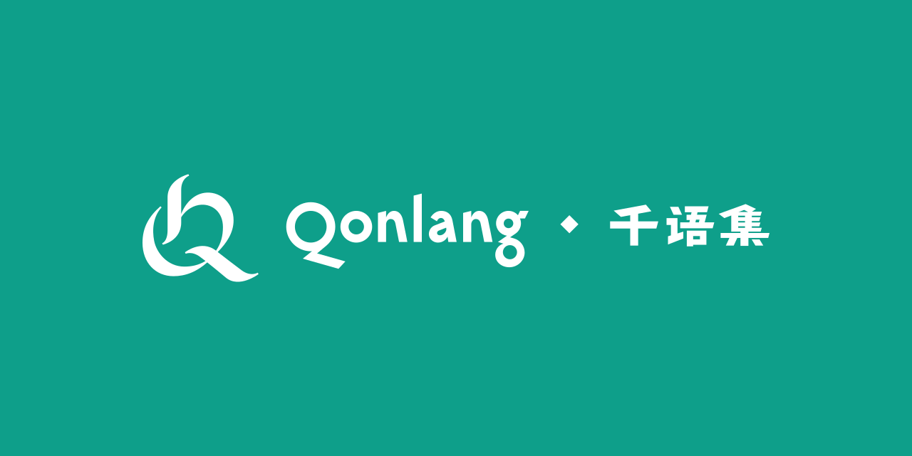

# 千语集 · Qonlang

给所有造语者的工作台：录入词汇与词根、制订音变规则、按音系自动标音、自动 gloss 例句、自定义文字与皮肤。
先验语、后验语、单语、语系都能用；软件不内置任何一门语言的术语，一切分类由你定义。

A workbench for every conlanger: lexicon and roots, sound-change rules, automatic
phonemic transcription, automatic interlinear glossing. Works for a priori and
a posteriori languages alike; nothing language-specific is baked in.

使用指南（分模块）：<https://kinnuch.github.io/cerf/qonlang/>（English: <https://kinnuch.github.io/cerf/qonlang/en/>）。设计大纲见 [docs/outline.md](docs/outline.md)。

界面有九种语言：简体中文、繁體中文、English、日本語、한국어、Français、Español、Русский、العربية，第一次打开跟着系统语言。

## 开发

```bash
npm install
npm run dev        # Electron 桌面版（热更新）
npm run dev:web    # 纯网页版
npm test           # 引擎层单元测试
npm run build:win  # Windows 安装包（另有 build:mac / build:linux）
npm run build:web  # 网页版静态文件 → dist/web
```

Windows 下若 PowerShell 提示「禁止运行脚本」，双击 `dev.cmd` 启动开发版，或改用 `npm.cmd run dev`。

## 打包与发布

| 平台 | 本机命令 | 产物 |
|---|---|---|
| Windows 解包目录（本机试用） | `npm run pack:win` | `dist/win-unpacked/Qonlang.exe` |
| Windows 安装包 | `npm run installer:win` | `dist/Qonlang-<版本>-setup.exe`（NSIS，可选目录，桌面快捷方式「千语集」） |
| macOS | `npm run installer:mac`（须在 macOS 上运行） | `dist/Qonlang-<版本>-mac-x64.dmg`、`-arm64.dmg` 及对应 `.zip` |
| Linux | `npm run build:linux`（须在 Linux 上运行） | `dist/Qonlang-<版本>.AppImage`、`dist/qonlang_<版本>_amd64.deb` |

**正式发布用 GitHub Actions 同时出三个平台**：`npm run release -- <版本号>`（或手动 `git tag v0.3.0 && git push origin v0.3.0`）。
推 tag 后 `.github/workflows/release.yml` 会在 Windows、macOS 与 Linux 的 runner 上各自打包，并把 Windows 安装包、macOS 的 dmg / zip（Intel 与 Apple Silicon）、Linux 的 AppImage / deb 一起挂到同名 GitHub Release。
Release 的说明从 `CHANGELOG.md` 与 `CHANGELOG.en.md` 里摘这个版本的一段（`scripts/release-notes.mjs`），两份更新日志每个版本都要有。
版本号带 `-` 的（`v1.0.0-beta.1`）标成预发布：装着正式版的检查更新收不到它，装着测试版的之后的测试版和正式版都收得到。

Windows 上打不了 macOS 包（electron-builder 只允许在 macOS 上构建 mac 目标）；本机想要 mac 包时用 `npm run fetch:release -- v0.3.0 mac` 把 CI 打好的产物拉到 `dist/release/<tag>/`。

安装包都没有签名。Windows 第一次运行弹出 SmartScreen 时点「更多信息 → 仍要运行」；macOS 版没有签名与公证（没有 Apple 开发者账号），首次打开会被 Gatekeeper 拦：右键应用 →「打开」（macOS 15 起改到「系统设置 → 隐私与安全性 → 仍要打开」），或在终端执行 `xattr -cr /Applications/Qonlang.app`。macOS / Linux 从源码运行用 `sh dev.sh`。

## 结构

```
src/main/        Electron 主进程：窗口、文件对话框、备份、偏好
src/preload/     IPC 桥
src/renderer/    界面（Svelte 5 + TypeScript）
  src/lib/core/      数据模型、工厂、序列化（纯 TS，无 UI 依赖）
  src/lib/platform/  平台适配层：Electron 与网页两套实现，同一接口
  src/lib/state/     运行时状态（Svelte runes）
  src/lib/i18n/      界面文案，九种语言（以中文为准；繁体由 npm run i18n:hant 从简体转）
  src/lib/engine/    音变、音系、形态、gloss 引擎（纯 TS）
  src/lib/script/    自定义文字：字体解析、内嵌字体、转写→文字映射
  src/lib/skin/      皮肤预设与可下载字体目录（均为 OFL）
  src/lib/export/    词典导出（HTML / Markdown / PDF / 模板）
  src/views/         各页面
scripts/         示例项目生成器（make-examples.ts / make-theusrin.ts）
tests/           Vitest
  fixtures/format-1.0/  1.0 存下的项目文件：之后的版本都要能打开（格式承诺），这些文件不许改
docs/            大纲与规则语言文档
```

## 许可

MIT
